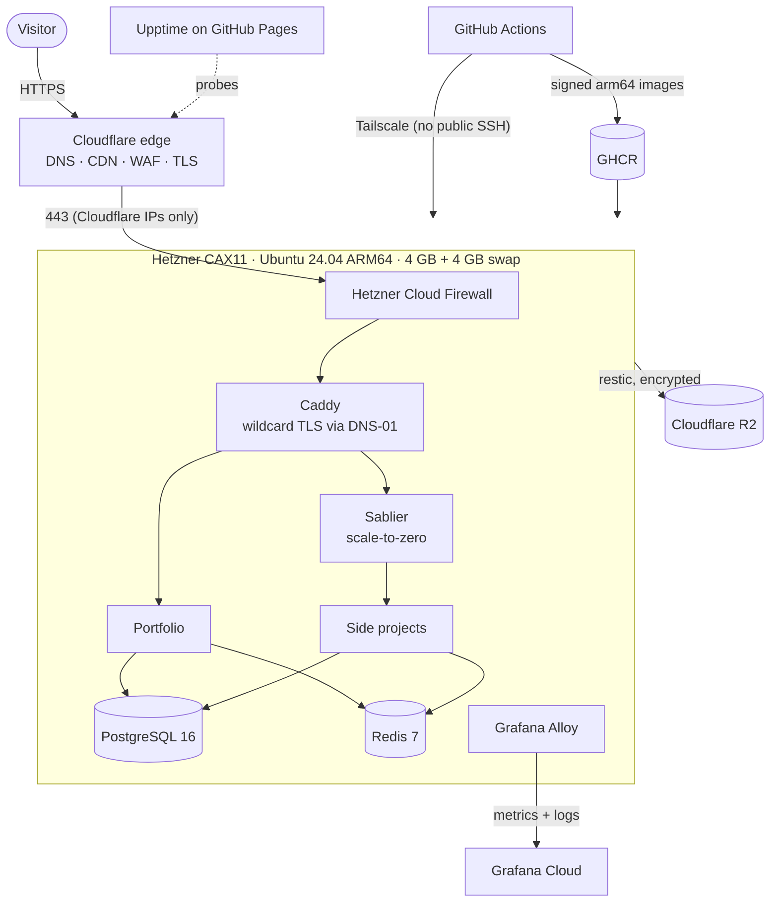

# project-infra

[](https://github.com/karan-sss/project-infra/actions/workflows/lint.yml)
[](https://github.com/karan-sss/project-infra/actions/workflows/terraform.yml)
[](https://github.com/karan-sss/project-infra/actions/workflows/build-caddy.yml)
[](https://github.com/karan-sss/project-infra/actions/workflows/deploy-platform.yml)

This repo is the production platform for **[karan-s.com](https://karan-s.com)**: my portfolio and a set of small side projects, self-hosted on a single ARM64 server for about **€7/month** (incl. VAT).

It uses no PaaS. Everything is code: Terraform provisions the server, network, DNS, TLS, WAF and VPN. cloud-init hardens the host. GitHub Actions builds signed multi-arch images and deploys them over a private tailnet. The repo exists to show the full path from an empty cloud account to an observable, backed-up, secured production platform.

## Architecture



## How a change reaches production

| Change | Pipeline | Effect |
|---|---|---|
| `terraform/**` | `terraform.yml`: plan + cost/replacement guard on the PR, **approved** apply on `main` | Infra updated in place |
| `platform/**` | `deploy-platform.yml`: cosign verify → rsync → `docker compose up` over Tailscale | Only changed containers restart |
| `images/caddy/**` | `build-caddy.yml`: native arm64/amd64 build → SBOM → sign → Trivy | New signed image in GHCR |
| An app repo | its CI calls `reusable-deploy-app.yml` | One app redeployed; no Terraform |

## Cost

| Item | €/month |
|---|---|
| Hetzner CAX11 (2 Ampere cores, 4 GB, 40 GB NVMe, 20 TB) | 6.48 |
| Primary IPv4 | 0.54 |
| Primary IPv6 | 0 |
| Cloudflare, R2, Tailscale, Grafana Cloud, healthchecks.io, GitHub Actions/GHCR/Pages | 0 (free tiers) |
| **Total** (incl. VAT, live Hetzner pricing) | **7.02** |

Every Terraform PR is priced against the live Hetzner pricing API and **fails above €7.50** ([ADR-0010](docs/adr/0010-plan-guard.md)).

## Security at a glance

- No public SSH: admin and CI access go through Tailscale only ([ADR-0008](docs/adr/0008-tailscale-admin-access.md)).
- Origin firewall accepts web traffic **only from Cloudflare** ([ADR-0006](docs/adr/0006-cloudflare-edge-and-origin-firewall.md)).
- SHA-pinned Actions, digest-pinned images, cosign signatures, SBOMs and Trivy scans ([ADR-0009](docs/adr/0009-supply-chain-security.md)).
- Databases are never exposed, use per-project credentials, and run behind a Docker socket proxy ([ADR-0013](docs/adr/0013-docker-socket-proxy.md), [ADR-0014](docs/adr/0014-data-access-and-public-repo-hygiene.md)).
- Least-privilege, expiring API tokens; secrets live only in GitHub Secrets, private R2 state and server-side `.env` files.

## Repository layout

```
terraform/          Hetzner server, IPs, firewall · Cloudflare DNS/TLS/WAF/R2 · Tailscale ACL
terraform/templates cloud-init: users, SSH lockdown, swap, Docker, Tailscale, timers
platform/           Docker Compose stack: Caddy, Postgres, Redis, Sablier, Alloy, backups
images/caddy/       Custom Caddy build (Cloudflare DNS + Sablier plugins)
scripts/            plan_guard.py (cost + replacement guard), leak_check.sh
.github/workflows/  lint · terraform · build · deploy · drift · restore drill
docs/adr/           Architecture Decision Records
docs/PLAN.md        Full implementation plan and task list
```

## Roadmap

- [x] Plan, ADRs and repository bootstrap
- [ ] Terraform: Hetzner + Cloudflare + Tailscale, state in R2
- [ ] cloud-init hardening (swap, Docker, Tailscale, metadata block)
- [ ] CI: lint, plan/apply with cost and replacement guard
- [ ] Signed multi-arch Caddy image + platform deploy
- [ ] Shared Postgres/Redis, Sablier scale-to-zero, reusable app deploy
- [ ] Backups + monthly restore drill
- [ ] Grafana Cloud observability, Upptime status page, drift detection

## Decisions

See [`docs/adr/`](docs/adr/). Each major choice (Hetzner, ARM64, R2 state, Tailscale, DNS-01, plan guard, backups, socket proxy and more) has a short record with its context and trade-offs.
